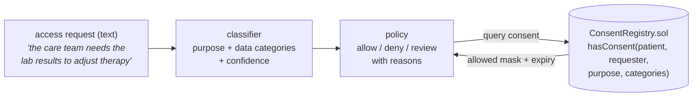

# ConsentChain

A patient-consent layer for health-data sharing. It does two things that belong
together: it keeps a tamper-evident, on-chain record of what each patient has
allowed, and it uses a small AI classifier to read a plain-language access
request and decide whether that request fits the consent on record.

The idea is simple to state and hard to get right in practice. A hospital, an
insurer, or a research team asks for some of a patient's data. The patient has
agreed to **some** uses of **some** data, for a limited time. ConsentChain turns
the free-text request into a structured claim — *this purpose, these data
categories* — checks it against the patient's recorded consent, and returns a
clear decision with reasons.

[](.github/workflows/ci.yml)
[](pyproject.toml)
[](LICENSE)

---

## Why it matters

Consent in healthcare is purpose-bound and category-bound. Agreeing to share
your lab results with your cardiologist for treatment is **not** the same as
agreeing to share your genetic data with a research team. Systems that treat
consent as a single yes/no flag lose that nuance and leak data.

ConsentChain keeps the nuance:

- **Purpose-scoped.** Consent for treatment does not authorise research, payment,
  or operations.
- **Category-exact.** Every data category a request touches must be covered.
- **Time-bound.** Consent expires; an expired record is no consent.
- **Auditable.** Every grant and revocation is an on-chain event with a version,
  so the full history can be reconstructed and no one can quietly rewrite it.
- **Private.** No names and no clinical data reach the chain — only hashed ids,
  small purpose codes, and a category bitmask.

## How it works



1. **Classifier (`classifier.py`).** A `FeatureUnion` of word (1-2 gram) and
   character (`char_wb`, 3-5) TF-IDF views feeds a regularised logistic regression
   for the purpose (treatment, payment, operations, research) and a one-vs-rest
   logistic regression for the data categories (a multi-label problem). Word
   n-grams capture phrasing; character n-grams capture recurring stems
   (*diagnos-*, *imaging*, *genom-*) so the model recognises wording it was not
   trained on. Being linear, every decision comes with the words that drove it —
   exactly what a consent system needs to be auditable.
2. **Policy (`policy.py`).** Reads the patient's consent for that requester and
   purpose from the registry and decides **allow**, **deny**, or **review**. Low
   classifier confidence routes the request to a human; a missing *sensitive*
   category (genetic, mental health) is always a hard denial.
3. **Registry (`chain/` + `contracts/`).** The `ConsentRegistry` contract stores,
   per `(patient, requester, purpose)`, which categories are allowed (a 16-bit
   mask) and until when. Only the operator (the consent-management service,
   acting on a patient's instruction) can grant or revoke, and every change bumps
   a version and emits an event.

The same service can run against the real compiled contract (on an in-memory
PyEVM node or a live JSON-RPC endpoint such as Anvil) or against an in-memory
fake with identical behaviour, so the tests and the API behave the same with or
without a chain.

## Quick start

```bash
python -m venv .venv && source .venv/bin/activate
pip install -e ".[dev]"

# Deploy to an in-memory EVM, grant consent, and evaluate requests:
python -m consentchain.cli demo

# Run the HTTP API:
uvicorn consentchain.main:app --reload
```

Example API calls:

```bash
# Record a patient's consent
curl -s -X POST localhost:8000/consent/grant -H 'content-type: application/json' -d '{
  "patient": "patient:alice", "requester": "clinic:oncology",
  "purpose": "treatment", "categories": ["diagnoses", "lab_results"], "ttl_days": 180
}'

# Evaluate a free-text access request against that consent
curl -s -X POST localhost:8000/access/evaluate -H 'content-type: application/json' -d '{
  "patient": "patient:alice", "requester": "clinic:oncology",
  "text": "The treating physician needs the recent lab results to adjust therapy."
}'
```

## The smart contract

`contracts/src/ConsentRegistry.sol` is compiled with a pinned `solc-js`
compiler, so no native toolchain is needed and the path is identical locally and
in CI:

```bash
make compile   # node contracts/compile.js -> contracts/artifacts/ConsentRegistry.json
```

The compiled artifact (ABI + bytecode) is committed, so the runtime and the
tests can deploy the contract to any JSON-RPC endpoint without a compiler.

Key design points:

- **No personal or clinical data on-chain.** A patient and a requester are each
  a `bytes32` id (a hash of a stable handle). Categories are bit positions;
  purposes are small codes.
- **Operator-only writes.** Only the consent-management service can grant or
  revoke, which stops anyone from forging consent.
- **Versioned history.** Each grant and revoke increments a version and emits an
  event, so the consent timeline is fully auditable.
- **Custom errors** (`NotOperator`, `ZeroParty`, `EmptyScope`, `PastExpiry`)
  make reverts cheap and clear.

## Configuration

Settings load from environment variables with the `CC_` prefix (see
`.env.example`):

| Variable               | Default             | Meaning                                       |
| ---------------------- | ------------------- | --------------------------------------------- |
| `CC_MIN_CONFIDENCE`    | `0.55`              | Below this, a request is routed to a reviewer |
| `CC_CHAIN_ENABLED`     | `true`              | Use a real chain for the registry             |
| `CC_CHAIN_RPC_URL`     | `http://anvil:8545` | JSON-RPC endpoint                             |
| `CC_CONTRACT_ADDRESS`  | `""`                | Deployed `ConsentRegistry` address            |
| `CC_CHAIN_PRIVATE_KEY` | `""`                | Operator key for signing writes               |

Never commit a real private key. Leave `CC_CHAIN_PRIVATE_KEY` empty for local
runs; the API and tests use an in-memory EVM or the in-memory fake.

## Evaluation: not the misleading 1.0

The classifier is trained on synthetic requests. Splitting that synthetic set at
random would report ~1.0 accuracy — a meaningless number, because train and test
would share the same phrasings and the model would be graded on memorisation. So
`consentchain.evaluation` runs a **phrase-disjoint split**: the purpose openers,
the category phrasings, and the purpose-context clauses are each partitioned, and
the test sentences are built **only from held-out phrasings**, so the test wording
was never seen in training.

```
$ python -m consentchain.evaluation
  purpose accuracy      : 0.90-0.94  # four-way; chance is 0.25
  purpose train-test gap: ~0.07      # small -> fits the signal, not the templates
  category micro-F1     : ~0.50      # multi-label, on *unseen* clinical wording
```

**Purpose** generalises genuinely well: on hand-written requests that are not in
the generator at all — *"the cardiology fellow wants the echocardiogram and
troponin trend"*, *"an IRB-approved cohort study needs the genomic variants"* —
it classifies the purpose correctly, and the small train/test gap shows it is
neither underfit nor overfit.

**Category extraction is harder, and the ~0.5 figure is reported honestly rather
than inflated.** Manual testing (not just the automated eval) drove this: the
first version used a toy vocabulary and silently mis-tagged real terms like
"echocardiogram" as *demographics*. The vocabulary now contains real clinical
terminology (troponin, HbA1c, CBC, MRI, BRCA, PHQ-9, CPT codes), so common terms
are recognised — but tagging a term with *no relative at all* in the training
vocabulary is genuinely hard, which the phrase-disjoint F1 of ~0.5 reflects.
Category extraction at production quality needs a clinical NER / medical ontology
or training on real requests; the model here demonstrates the pipeline and is
honest about that boundary. Purpose classification and the on-chain consent model
are the robust parts.

## Testing

```bash
ruff check consentchain tests
pytest --cov=consentchain --cov-report=term-missing --cov-fail-under=80
```

The suite covers the consent vocabulary, the classifier (via the phrase-disjoint
evaluation, asserting both generalisation and a bounded overfitting gap), the
policy decisions (allow / deny / review, expiry, and sensitive-category handling),
the HTTP API, and the contract (deployed to an in-memory EVM, including the
operator and input guards). Tests that deploy the contract carry the `chain`
marker.

## Documentation

- `docs/architecture.md` — the full picture and the data flow.
- `docs/adr/` — the main design decisions and why they were made.
- `docs/estudio/` — a study guide in Spanish, for learning the project in depth.

## A note on scope

ConsentChain is a reference implementation, not a certified medical device. It
shows a clean design for purpose-bound, auditable consent. A production system
would add authenticated identities, a real key-management story for the
operator, a formal audit of the contract, and integration with the data systems
it protects.

## License

[MIT](LICENSE) © Angelo David Padilla Romero
